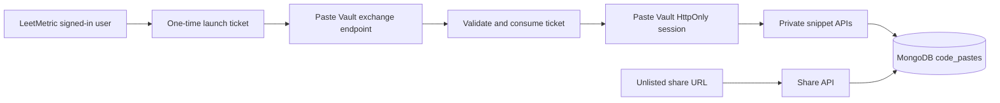

# Paste Vault

> A private, searchable developer workspace for code snippets, LeetCode solutions, reusable patterns and debugging notes — connected to LeetMetric with secure single sign-on.

[](https://paste-app-wine.vercel.app)
[](https://react.dev/)
[](https://vite.dev/)
[](https://www.mongodb.com/)
[](LICENSE)

Paste Vault helps developers preserve both the implementation and the reasoning behind it. Save accepted solutions, snippets, templates and notes in one place, then retrieve them through full-text search, filters, tags and problem context.

## Product highlights

- **Private by default:** new snippets are private and scoped to the signed-in account.
- **LeetMetric SSO:** a short-lived, one-time launch ticket connects the two applications without sharing JWT signing secrets.
- **Structured solution journal:** record the problem, language, difficulty, topic, intuition, time and space complexity, key takeaways and edge cases.
- **Searchable library:** search titles, code, problem titles, topics and tags; filter by language, category and pinned state.
- **Version history:** edits create revision snapshots; restore an earlier version when needed.
- **Controlled sharing:** create unlisted links with 1-day, 7-day, 30-day or no-expiry policies; add password protection, update expiration or revoke access at any time.
- **Credential hygiene warning:** a client-side advisory detects several common token, private-key and database-URI patterns before saving. Users must acknowledge warnings, but this is not a substitute for secret management or a security scanner.
- **Developer-friendly rendering:** syntax highlighting, copy-to-clipboard, language-aware code downloads and direct links to the original problem.
- **Workspace insights:** track saved snippets, pinned references, active share links, stored content and language distribution.
- **Collections:** organize snippets into up to 100 color-coded folders, move snippets between collections, and safely delete a collection without deleting its snippets.
- **Portable backup:** export the full vault as versioned JSON and import it into another Paste Vault account. Imported snippets always become private.
- **Responsive interface:** polished desktop/mobile layout with persisted light and dark themes.
- **Installable shell:** PWA support for a familiar app-like experience.

## Screenshots

| Workspace | Snippet view |
| --- | --- |
|  |  |

## Technology

| Layer | Tools |
| --- | --- |
| Frontend | React 18, Vite, React Router |
| UI | Tailwind CSS, custom responsive CSS, Lucide |
| Code display | highlight.js |
| State and feedback | React Context, React Hot Toast |
| Backend | Vercel serverless API routes |
| Database | MongoDB with Mongoose |
| Authentication | LeetMetric SSO handoff, JWT session cookie |
| Quality | ESLint, Node test runner, GitHub Actions |

## Application routes

| Route | Purpose |
| --- | --- |
| `/` | Workspace overview and quick capture |
| `/pastes` | Searchable snippet library |
| `/pastes/:id` | Snippet details, editing, sharing and revision history |
| `/profile` | Account profile, workspace activity and security information |
| `/api/folders` | List or create collections |
| `/api/folders/:id` | Rename or safely delete a collection |
| `/api/export` | Paginated, versioned JSON backup export |
| `/api/import` | Import private snippets in validated batches |
| `/share/:shareId` | Publicly reachable unlisted snippet view |

## Architecture and authentication

Paste Vault does not own user passwords. LeetMetric authenticates the user and issues a random 256-bit, short-lived, one-time launch ticket. The ticket is passed in the URL fragment so it is not included in the initial HTTP request. Paste Vault hashes the ticket, atomically consumes it, validates the linked user's current token version, and creates a separate HttpOnly session signed with Paste Vault's own JWT secret.

Both deployments may use the same MongoDB database, but they must use **different JWT signing secrets**. LeetMetric remains the source of truth for account identity and account deletion; Paste Vault stores user-owned snippets in its own collection.



## Local development

### Prerequisites

- Node.js 20 or newer recommended
- npm
- MongoDB connection string
- A LeetMetric environment for issuing valid launch tickets when testing authenticated flows

### Setup

```bash
git clone https://github.com/naitik2043/Paste-App.git
cd Paste-App
npm install
cp .env.example .env
```

Set the variables in `.env`:

```env
MONGODB_URI=your_mongodb_connection_string
JWT_SECRET=your_unique_random_secret_at_least_32_characters
```

Use a unique random `JWT_SECRET` for Paste Vault. Do not copy the LeetMetric JWT secret.

Start the development server:

```bash
npm run dev
```

Run the full quality gate:

```bash
npm run check
```

Authenticated API routes require a valid session. Use the LeetMetric dashboard's Code Vault handoff to exercise the complete sign-in flow.

## Deployment configuration

Configure environment variables in the Vercel project settings, not in source control.

**Paste-App / Paste Vault**
- `MONGODB_URI`: database connection string.
- `JWT_SECRET`: independent random secret, at least 32 characters.

**LeetMetric**
- `PASTE_APP_URL`: `https://paste-app-wine.vercel.app`.
- `MONGODB_URI`: same database used by Paste Vault.
- `JWT_SECRET`: LeetMetric's separate random session secret.

Redeploy both applications after configuration changes. Never commit `.env`, connection strings, private keys or tokens.

## API overview

| Method | Endpoint | Purpose |
| --- | --- | --- |
| POST | `/api/auth/exchange` | Consume the one-time LeetMetric launch ticket |
| GET | `/api/auth/me` | Read the current Paste Vault session |
| POST | `/api/auth/logout` | Clear the session cookie |
| GET / POST | `/api/pastes` | Search/list or create owned snippets |
| GET / PATCH / DELETE | `/api/pastes/:id` | Read or manage an owned snippet |
| POST | `/api/pastes/:id/restore` | Restore a saved revision |
| GET | `/api/stats` | Workspace and language insights |
| GET / POST | `/api/share/:shareId` | Read an unlisted snippet or unlock a password-protected share |

## Security and privacy

- Private API operations enforce server-side ownership checks.
- State-changing requests apply same-origin checks and rate limiting.
- Session cookies are HttpOnly; deployed cookies use Secure settings.
- Private API responses are non-cacheable, and unlisted pages send no-index headers.
- The application displays code; it does not execute submitted snippets.
- Unlisted URLs are bearer links: anyone who obtains an active link can view its snippet until it expires or is revoked. Password-protected links require a separate password.
- Share passwords are salted and derived with Node.js scrypt; the plaintext password is never stored. Password verification uses a constant-time comparison and is rate-limited.
- JSON backups intentionally exclude active share IDs, share passwords and revision history. Imports always create private snippets so a backup cannot silently reactivate old public links.
- Do not store passwords, API keys, private keys, session tokens or sensitive personal information in Paste Vault.

The current product focuses on a private, single-owner learning and reference workspace. Public snippet discovery, real-time collaborative editing and client-side zero-knowledge encryption are not currently part of the product.

## Roadmap

- [ ] Share-link view limits
- [ ] Browser-side encryption for a dedicated secure-share mode
- [ ] Markdown and GitHub Gist import/export
- [ ] Multi-file snippets and downloadable archives
- [ ] Keyboard shortcuts and editor ergonomics
- [ ] More comprehensive API and browser integration tests

## License

MIT. See [LICENSE](LICENSE).
