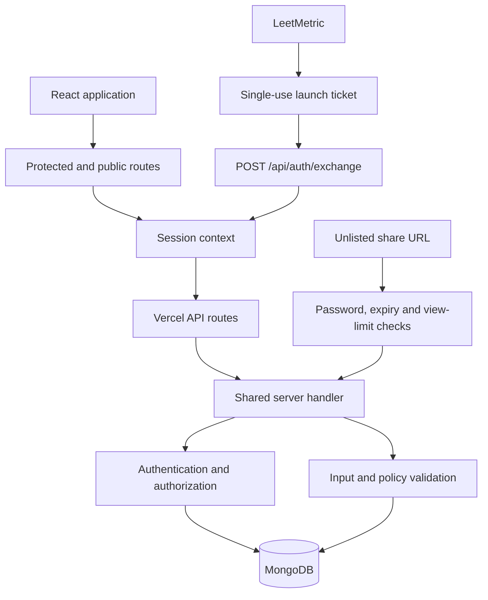

# Paste Vault

<p align="center">
  <strong>A personal developer workspace for code, problem-solving notes, and reusable knowledge.</strong>
  <br />
  Save the implementation. Keep the reasoning. Find it when you need it again.
</p>

<p align="center">
  <a href="https://paste-app-wine.vercel.app/"></a>
  <a href="https://github.com/naitik2043/Paste-App/actions/workflows/quality.yml"></a>
  
  
  
  <a href="LICENSE"></a>
</p>

<p align="center">
  <a href="https://paste-app-wine.vercel.app/">Open Paste Vault</a> ·
  <a href="https://leetmetric-sooty.vercel.app/">LeetMetric</a> ·
  <a href="#getting-started">Getting started</a> ·
  <a href="#security-and-privacy">Security</a>
</p>

---

## Overview

Paste Vault is a private-by-default code and knowledge management workspace for developers. It brings programming solutions, reusable snippets, templates, and the thinking behind them into one searchable library.

A saved solution can include its programming language, problem reference, difficulty, topic, approach, time and space complexity, tags, and key takeaways. Collections, version history, analytics, and controlled sharing make that knowledge easier to organize, revisit, and reuse.

Paste Vault works as a standalone application and can also connect to **[LeetMetric](https://leetmetric-sooty.vercel.app/)** through a short-lived, single-use sign-in handoff.

> **Product boundary:** Paste Vault stores and displays code as text. It does not execute submitted code, provide runtime benchmarks, or automatically import LeetCode activity.

## Screenshots

<table>
  <tr>
    <td align="center"><strong>Workspace dashboard</strong></td>
    <td align="center"><strong>Snippet details</strong></td>
  </tr>
  <tr>
    <td width="50%"></td>
    <td width="50%"></td>
  </tr>
</table>

## Product capabilities

### Code library

- Save code snippets, DSA solutions, templates, and technical notes.
- Keep each entry private by default and scoped to its owner.
- Record problem title and URL, language, difficulty, topic, approach, complexity, key takeaways, and tags.
- Search saved entries across titles, code, problem names, topics, approaches, takeaways, and tags.
- Filter by programming language, entry type, collection, and pinned status.
- Copy code, download a language-aware snippet file, and view syntax-highlighted content.
- Pin frequently used references and browse recently updated snippets.

### Collections and revision history

- Create up to 100 color-coded collections.
- Move snippets between collections and filter the library by collection.
- Rename collections without changing their snippets.
- Delete a collection safely: its snippets are moved to **Unfiled**, not deleted.
- Editing a snippet creates a revision snapshot.
- Restore an earlier revision while keeping the current content in history.

### Cross-language solution comparison

The **Compare** workspace lets you inspect two saved implementations of the same problem side by side.

1. Save a solution as a **LeetCode solution** and provide its problem title.
2. Save another implementation for that problem in a different language.
3. Open **Compare**, select the problem, then choose a language and saved implementation for each panel.
4. Review the code, line and character counts, and the time/space complexity notes saved with each implementation.

The comparison view uses the saved solutions in the most recent 500 snippets. It displays developer-entered complexity notes; it does not run the implementations or measure their execution time. Language choices are based on the implementations saved for the selected problem.

### Language support

The language catalog is shared between the create, edit, filter, and comparison experiences. The API validates language values on the server.

| Group | Available choices |
| --- | --- |
| General-purpose | C, C++, C#, Go, Java, JavaScript, Kotlin, Lua, Perl, PHP, Python, R, Ruby, Rust, Scala, Swift, TypeScript |
| Web and data | CSS, GraphQL, HTML, JSON, SQL |
| Markup, shell and configuration | Bash, Dockerfile, Markdown, PowerShell, XML, YAML |
| Additional editor modes | React JSX, React TSX, Plain text |

Syntax highlighting is provided by the installed Highlight.js language bundle. When a grammar is not available in that bundle, the code view falls back to plain-text rendering.

### DSA and workspace analytics

The authenticated **Analytics** page summarizes data already saved in the current account:

- Total snippets and saved DSA solutions.
- Number of distinct languages and problem topics.
- Easy, Medium, and Hard solution distribution.
- Most-used languages and frequently recorded topics.
- New snippets created in each of the last six calendar months.

Analytics are derived from the user's Paste Vault records. They are not LeetCode profile statistics and do not imply that a problem was accepted on an external platform.

### Controlled sharing

- Create an unlisted, read-only link when a snippet needs to be shared.
- Keep sharing disabled until the owner explicitly enables it.
- Optionally protect a link with a password.
- Choose a lifetime of 1 day, 7 days, 30 days, or no expiration.
- Set a maximum of 1, 5, 10, 25, or 100 successful views, or leave the link unlimited.
- Copy the link, update its policy, or disable it to make the snippet private again.

Unlisted links are bearer links: anyone who obtains an active link may be able to access the shared content, subject to its password, expiry, and view-limit policy.

### Accounts and LeetMetric integration

- Standalone registration with email verification.
- Login, logout, password reset, password change, and verification email resend.
- Optional standalone email/password sign-in for an existing LeetMetric identity.
- LeetMetric SSO through an expiring, single-use launch ticket.
- Editable developer profile with bio, location, avatar, website, GitHub, and LinkedIn links.
- Light and dark themes.
- Session management through an HttpOnly cookie.

Standalone credentials are stored separately from the shared user identity. Linking is based on verified email ownership; accounts with different email addresses are not merged automatically. For shared identity linking, both applications must use the same trusted user database.

### Import, export, and installability

- Export snippets and collections as a versioned JSON backup.
- Import a Paste Vault JSON backup into an account.
- Imported snippets are always private; existing snippets are not overwritten.
- Installable Progressive Web App shell with an auto-updating service worker.

The backup does not include revision history, share passwords, or active share tokens.

## Technology stack

| Layer | Technology |
| --- | --- |
| Frontend | React 18, Vite 5, React Router |
| UI and styling | Tailwind CSS, custom responsive CSS, Lucide icons |
| Code rendering | Highlight.js |
| Client state | React Context and component state |
| Notifications | React Hot Toast |
| API | Vercel serverless functions, Node.js 26 |
| Database | MongoDB, Mongoose |
| Authentication | JSON Web Tokens, HttpOnly cookies, Node.js scrypt |
| Transactional email | Resend |
| PWA | vite-plugin-pwa, Workbox |
| Code quality | ESLint, Node.js test runner, GitHub Actions |

## Application architecture

The browser application communicates with Vercel API functions. API route files delegate to a shared handler in `server/index.js`, which validates requests, authenticates the current user, enforces ownership checks, and reads or writes MongoDB documents.



### MongoDB collections

| Collection | Purpose |
| --- | --- |
| `users` | Shared application identity, provider metadata, and Paste Vault profile fields |
| `paste_credentials` | Standalone email credentials, password hashes, verification state, and token digests |
| `integration_tickets` | Expiring, single-use LeetMetric launch ticket hashes |
| `code_pastes` | User-owned snippets, learning metadata, sharing policy, and revision snapshots |
| `paste_folders` | User-owned collections and display settings |

Snippet and folder queries are scoped to the authenticated user. The server checks ownership when reading, changing, moving, sharing, or deleting a record; client-side filters are not used as authorization controls.

## Application routes

### Public routes

| Route | Description |
| --- | --- |
| `/` | Product landing page |
| `/about` | Product overview |
| `/help` | Help centre and FAQs |
| `/privacy` | Privacy overview |
| `/terms` | Terms of use |
| `/login` | Standalone login and LeetMetric sign-in entry |
| `/signup` | Standalone account registration |
| `/verify-email` | Email verification |
| `/forgot-password` | Password reset request |
| `/reset-password` | Set a new password |
| `/share/:shareId` | Read-only shared snippet |

### Authenticated routes

| Route | Description |
| --- | --- |
| `/dashboard` | Workspace overview, quick capture, and recent snippets |
| `/pastes` | Searchable library, collections, filters, and JSON backup |
| `/pastes/:id` | Snippet details, editing, sharing, and version history |
| `/analytics` | DSA and workspace analytics |
| `/compare` | Cross-language solution comparison |
| `/profile` | Developer profile and workspace activity |
| `/settings` | Sign-in methods, password, theme, and privacy settings |

Protected routes require a valid Paste Vault session. The Vercel configuration rewrites client-side routes to the React application and marks private workspace and authentication routes as non-indexable.

## API reference

All endpoints are served under `/api`. Protected endpoints require the Paste Vault session cookie.

| Method | Endpoint | Description |
| --- | --- | --- |
| `POST` | `/api/auth/register` | Create a standalone account and send a verification email |
| `POST` | `/api/auth/login` | Sign in with verified email credentials |
| `POST` | `/api/auth/logout` | End the current session |
| `GET` | `/api/auth/me` | Read the current session identity |
| `POST` | `/api/auth/exchange` | Exchange a LeetMetric launch ticket |
| `POST` | `/api/auth/link-email` | Add standalone sign-in to the authenticated identity |
| `POST` | `/api/auth/verify` | Verify an email address |
| `POST` | `/api/auth/resend-verification` | Resend an email verification link |
| `POST` | `/api/auth/forgot-password` | Request a password reset |
| `POST` | `/api/auth/reset-password` | Consume a password reset token |
| `POST` | `/api/auth/password` | Change the current account password |
| `PATCH` | `/api/auth/profile` | Update Paste Vault profile details |
| `GET, POST` | `/api/pastes` | List/search snippets or create a snippet |
| `GET, PATCH, DELETE` | `/api/pastes/:id` | Read, update, or delete an owned snippet |
| `POST` | `/api/pastes/:id/restore` | Restore a saved revision |
| `GET, POST` | `/api/folders` | List or create collections |
| `PATCH, DELETE` | `/api/folders/:id` | Rename or delete a collection |
| `GET` | `/api/stats` | Read workspace and DSA analytics |
| `GET` | `/api/export` | Export a paginated JSON backup |
| `POST` | `/api/import` | Import a validated batch of snippets |
| `GET, POST` | `/api/share/:shareId` | Read a shared snippet or submit its password |

## Getting started

### Prerequisites

- Node.js **26.x** (see `.nvmrc`).
- npm.
- A MongoDB database and connection string.
- A Resend account and verified sender domain for production email delivery.

### 1. Clone the repository

```bash
git clone https://github.com/naitik2043/Paste-App.git
cd Paste-App
npm ci
```

### 2. Configure environment variables

Copy the example environment file:

**Windows PowerShell**

```powershell
Copy-Item .env.example .env
```

**macOS / Linux**

```bash
cp .env.example .env
```

Set the following values in `.env`:

| Variable | Required | Description |
| --- | --- | --- |
| `MONGODB_URI` | Yes | MongoDB connection string. For LeetMetric SSO, use the trusted database containing the shared `users` collection. |
| `JWT_SECRET` | Yes | Independent Paste Vault session secret (at least 32 characters). Do not reuse LeetMetric's JWT secret. |
| `PUBLIC_APP_URL` | Production email flows | Canonical HTTPS origin used to create verification and reset links. |
| `RESEND_API_KEY` | Production email flows | Resend API key for transactional email. |
| `RESEND_FROM_EMAIL` | Production email flows | Sender identity on a domain verified in Resend. |

Generate a unique session secret:

```bash
node -e "console.log(require('crypto').randomBytes(48).toString('hex'))"
```

Never commit a populated `.env` file or put credentials in frontend code.

### 3. Run the application

Start the Vite frontend:

```bash
npm run dev
```

This starts the frontend development server. The API endpoints are Vercel serverless functions, so Vite alone does not provide the full backend.

To run the frontend and API routes together locally, install the Vercel CLI and use its development runtime:

```bash
npm install --global vercel
vercel dev
```

Configure the environment variables before testing authenticated or database-backed features. In local development without Resend credentials, the application provides development-only verification/reset links; this fallback is disabled in production.

For account-linking behavior and the production email setup, see [AUTH_SETUP.md](AUTH_SETUP.md).

## Quality checks

Run the project checks before opening a pull request:

```bash
npm run lint
npm test
npm run build
```

Or run the complete local quality gate:

```bash
npm run check
```

The quality gate runs ESLint, frontend utility syntax checks, API/server syntax checks, the Node.js test suite, and a production Vite build. GitHub Actions additionally installs the lockfile with `npm ci` and audits production dependencies for high-severity vulnerabilities.

Current test files cover route utilities, request security, share-password security, standalone authentication, validation, language catalog behavior, downloads, SSO launch-ticket handling, and client-side secret-warning heuristics.

## Deployment

Paste Vault is configured for Vercel.

1. Import the repository into Vercel.
2. Set the production environment variables listed above.
3. Set `PUBLIC_APP_URL` to the canonical HTTPS deployment origin.
4. Verify the Resend sender domain and test verification and password-reset emails.
5. Confirm the deployment can connect to MongoDB.
6. When enabling LeetMetric SSO, configure both applications to use the same trusted user identity database and verify the one-time ticket issuer/exchange flow.
7. Test registration, login, snippet ownership, sharing policies, import/export, analytics, and direct navigation to nested routes.

The public product pages are indexable. Authentication pages, private workspace pages, analytics, comparison pages, and unlisted share pages are configured to stay out of search indexes.

## Security and privacy

Paste Vault includes several security controls:

- Passwords are hashed with Node.js scrypt using per-password random salts.
- Email verification and password reset use random, single-use, expiring tokens; only SHA-256 token digests are stored.
- LeetMetric launch tickets are short-lived, single-use, and stored as SHA-256 hashes.
- Session JWTs are delivered through HttpOnly cookies with SameSite=Lax and Secure enabled in production.
- Password changes and resets invalidate older sessions through a token-version check.
- Mutating requests are checked for same-origin behavior and sensitive actions have rate limits.
- Share passwords are hashed with scrypt and compared using a timing-safe check.
- Server-side validation enforces content limits, supported languages, allowed categories, LeetCode URL hosts, collection ownership, and sharing policies.
- Snippet content is rendered as highlighted text; it is not executed by the application.

### Important security boundaries

- The secret-warning feature is a client-side heuristic. It is not a complete secrets scanner and cannot guarantee that credentials will be detected.
- An unlisted URL is a bearer link, not an authenticated private workspace session. Share it only with people you trust.
- The current rate limiter stores counters in process memory. It is not a distributed rate limiter or a substitute for infrastructure-level abuse protection.
- Paste Vault does not currently provide end-to-end encryption for stored snippets.
- Do not use the service to store passwords, private keys, production credentials, or other secrets.

For responsible disclosure instructions, read [SECURITY.md](SECURITY.md).

## Repository structure

```text
Paste-App/
├── api/                       # Vercel serverless route entry points
│   ├── auth/                  # Authentication and account routes
│   ├── folders/               # Collection routes
│   ├── pastes/                # Snippet and revision routes
│   ├── share/                 # Public share route
│   ├── export.js
│   ├── import.js
│   └── stats.js
├── public/                    # Static assets, favicon, robots and sitemap
├── server/
│   ├── index.js               # Shared API handler and MongoDB models
│   ├── standalone-auth.js     # Standalone authentication flows
│   ├── validation.js          # Server-side input and policy validation
│   ├── security.js            # Same-origin checks and in-process rate limiting
│   └── share-security.js      # Share-password hashing and verification
├── src/
│   ├── components/            # Shared UI and application shell
│   ├── context/               # Session provider and hooks
│   ├── data/                  # Navigation and supported language catalog
│   ├── pages/                 # Public, account, workspace and analytics pages
│   ├── utils/                 # Launch-ticket, download and secret-warning helpers
│   ├── App.jsx                # Client-side route definitions
│   ├── index.css
│   └── vault.css              # Product styling and responsive layouts
├── .github/
│   ├── workflows/quality.yml  # CI quality gate
│   └── dependabot.yml         # Dependency update configuration
├── AUTH_SETUP.md              # Authentication and account-linking setup
├── CONTRIBUTING.md            # Contribution guidelines
├── SECURITY.md                # Vulnerability reporting policy
├── .env.example               # Environment variable template
├── package.json
├── vercel.json
└── README.md
```

## Contributing

Contributions are welcome. Please read [CONTRIBUTING.md](CONTRIBUTING.md) before making changes.

- Keep changes focused and preserve private-by-default behavior.
- Add or update tests for changed behavior.
- Keep server-side ownership and validation checks intact.
- Update the README when routes, configuration, or product behavior changes.
- Never commit credentials, database exports, or private user snippets.

## License

This project is licensed under the [MIT License](LICENSE).

---

<p align="center">
  Built for developers who want to keep more than just the code.
  <br />
  <a href="https://github.com/naitik2043">GitHub</a> ·
  <a href="https://leetmetric-sooty.vercel.app/">LeetMetric</a> ·
  <a href="https://paste-app-wine.vercel.app/">Paste Vault</a>
</p>
