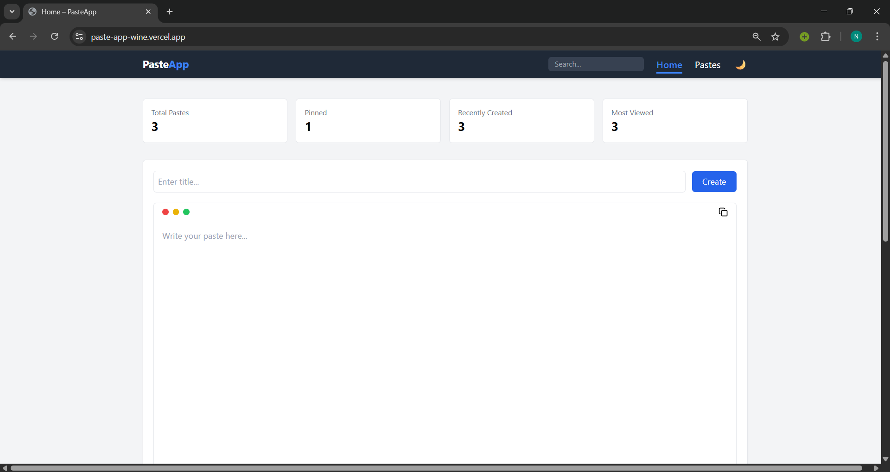
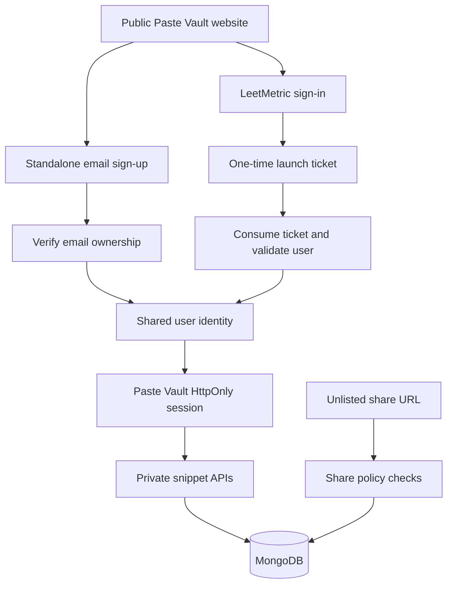

# Paste Vault

> An independent developer workspace for programming solutions, reusable snippets, templates and technical notes — with optional LeetMetric single sign-on.

[](https://paste-app-wine.vercel.app)
[](https://github.com/naitik2043/Paste-App/actions/workflows/quality.yml)
[](https://react.dev/)
[](https://vite.dev/)
[](https://www.mongodb.com/)
[](LICENSE)

Paste Vault helps developers preserve both the implementation and the reasoning behind it. Save accepted solutions, snippets, templates and notes in one place, then retrieve them through keyword search, filters, tags, collections and problem context.

## Product experience

Paste Vault is designed to work in two ways:

- **Standalone:** create an account directly with an email address and password. Email verification is required before the first sign-in.
- **LeetMetric integration:** continue to launch Paste Vault from an authenticated LeetMetric dashboard using the existing one-time ticket and single sign-on flow.

Both methods resolve to the same user identity when the verified email matches an existing user record in the shared database. Different email addresses are not automatically merged.

## Features

- **Private by default:** new snippets are private and scoped to the signed-in account.
- **Standalone authentication:** registration, email verification, sign-in, forgot/reset password, password changes and secure HttpOnly sessions.
- **LeetMetric SSO:** one-time, short-lived launch tickets connect the two applications without sharing JWT signing secrets. LeetMetric users can add standalone email/password sign-in from Settings after verifying their account email.
- **Editable developer profile:** update display name, bio, location, avatar URL, website, GitHub and LinkedIn details.
- **Account settings:** manage sign-in methods, password security, light/dark theme and sign-out.
- **Structured solution journal:** record the problem, language, difficulty, topic, intuition, time and space complexity, key takeaways and edge cases.
- **Searchable library:** search titles, code, problem titles, topics and tags; filter by language, category, collection and pinned state.
- **Collections:** organize snippets into up to 100 color-coded folders, move snippets between collections, and safely delete a collection without deleting its snippets.
- **Version history:** edits create revision snapshots; restore an earlier version when needed.
- **Controlled sharing:** create unlisted links with 1-day, 7-day, 30-day or no-expiry policies; add password protection, cap successful views at 1, 5, 10, 25 or 100, and revoke access at any time.
- **Credential hygiene warning:** a client-side advisory detects several common token, private-key and database-URI patterns before saving. This is a cautionary aid, not a complete secret scanner.
- **Developer-friendly rendering:** syntax highlighting, copy-to-clipboard, language-aware code downloads and direct links to the original problem.
- **Workspace insights:** track saved snippets, pinned references, active share links, stored content, language mix, difficulty distribution, topic coverage and six-month library activity.
- **DSA analytics:** review saved-solution difficulty, language mix, popular topics and monthly snippet creation trends.
- **Cross-language comparison:** select a problem and compare two saved implementations side by side, including syntax, code size and recorded time/space complexity.
- **Expanded language selection:** choose from 30+ programming, query, markup and configuration languages when creating, editing or filtering snippets.
- **Portable backup:** export the vault as versioned JSON and import it into another Paste Vault account. Imported snippets always become private.
- **Responsive product website:** public landing page, About, Help, Privacy and Terms pages, mobile navigation and light/dark themes.
- **Installable shell:** PWA support for a familiar app-like experience.

## Screenshots

| Workspace | Snippet view |
| --- | --- |
|  |  |

## Technology

| Layer | Tools |
| --- | --- |
| Frontend | React 18, Vite, React Router |
| UI | Tailwind CSS, custom responsive CSS, Lucide |
| Code display | highlight.js |
| State and feedback | React Context, React Hot Toast |
| Backend | Vercel serverless API routes |
| Database | MongoDB with Mongoose |
| Authentication | scrypt password hashing, email verification, JWT HttpOnly cookie, LeetMetric SSO |
| Email delivery | Resend transactional email API |
| Quality | ESLint, Node test runner, GitHub Actions |

## Routes

### Public pages

| Route | Purpose |
| --- | --- |
| `/` | Product landing page |
| `/about` | Product overview |
| `/help` | FAQs and usage guidance |
| `/privacy` | Privacy overview |
| `/terms` | Product terms |
| `/login` | Standalone sign-in and LeetMetric SSO entry |
| `/signup` | Create an independent account |
| `/verify-email` | Verify an email address |
| `/forgot-password` | Request a password-reset link |
| `/reset-password` | Set a new password |
| `/share/:shareId` | Unlisted shared snippet |

### Authenticated workspace

| Route | Purpose |
| --- | --- |
| `/dashboard` | Workspace overview and quick capture |
| `/pastes` | Searchable snippet library, folders and backup |
| `/analytics` | DSA and workspace analytics |
| `/compare` | Side-by-side comparison of saved solutions across languages |
| `/pastes/:id` | Snippet details, editing, sharing and revisions |
| `/profile` | Editable developer profile and workspace activity |
| `/settings` | Account methods, password, appearance and privacy controls |

### API

| Endpoint | Purpose |
| --- | --- |
| `/api/auth/register` | Create an account and send verification email |
| `/api/auth/link-email` | Add standalone email/password sign-in to an authenticated LeetMetric identity |
| `/api/auth/login` | Sign in with verified email credentials |
| `/api/auth/verify` | Consume a one-time email verification token |
| `/api/auth/resend-verification` | Request another verification email |
| `/api/auth/forgot-password` | Request a password-reset email |
| `/api/auth/reset-password` | Consume a one-time password-reset token |
| `/api/auth/password` | Change the signed-in account password |
| `/api/auth/profile` | Update editable profile details |
| `/api/auth/exchange` | Exchange a LeetMetric launch ticket |
| `/api/auth/me` | Return the current session identity |
| `/api/auth/logout` | Clear the session cookie |
| `/api/folders`, `/api/folders/:id` | List, create, rename or delete collections |
| `/api/export`, `/api/import` | Export or import the vault |
| `/api/pastes`, `/api/pastes/:id` | Manage snippets and revision history |
| `/api/share/:shareId` | Read an unlisted snippet through its share policy |

## Architecture

Both sign-in methods converge on the same application user record. Paste Vault stores standalone password credentials separately from the shared user identity. It stores only salted password hashes and SHA-256 digests of one-time verification/reset tokens.



### Account and data model

- `users`: shared application identity and authentication-provider metadata. Paste Vault profile fields live in an isolated `pasteProfile` subdocument so editing this profile does not overwrite LeetMetric's account profile.
- `paste_credentials`: standalone email credential, per-account password salt/hash, verification state and one-time token digests.
- `integration_tickets`: hashed, expiring, single-use LeetMetric launch tickets.
- `code_pastes`, `paste_folders`: user-owned snippets, revisions and collections.

Account linking is intentionally email-based and requires ownership verification. A standalone registration that matches an existing user email links a new email credential to that user ID. Accounts with different addresses are not silently merged. If the LeetMetric and Paste Vault deployments do not share the same user database/identity records, the SSO integration must be configured to point to the same trusted user store before using both sign-in methods as one account.

### Security controls

- Passwords use Node.js scrypt with a fresh random salt and constant-time hash comparison.
- Verification and reset tokens are random, single-use, expire, and are stored as SHA-256 digests.
- Password reset/change increments the user's token version to invalidate existing sessions.
- Session cookies are HttpOnly, SameSite=Lax and Secure in production.
- Mutating endpoints validate same-origin requests and authentication endpoints have action-specific rate limits.
- Profile external links accept HTTPS URLs only.
- Production email action links use the configured canonical `PUBLIC_APP_URL`; request Host headers are not trusted to construct those links.
- Private snippets require an authenticated owner session. Shared snippets are protected by their explicit share policy.

## Local development

### Prerequisites

- Node.js 26.x and npm
- MongoDB connection string
- Resend account with a verified sending domain for real verification and password-reset emails

### Setup

```bash
git clone https://github.com/naitik2043/Paste-App.git
cd Paste-App
npm ci
cp .env.example .env
```

Configure the environment:

| Variable | Required | Purpose |
| --- | --- | --- |
| `MONGODB_URI` | Yes | MongoDB connection string. Use the trusted shared user database for LeetMetric account linking. |
| `JWT_SECRET` | Yes | Independent Paste Vault session secret, minimum 32 characters. Never reuse LeetMetric's JWT secret. |
| `PUBLIC_APP_URL` | Production | Canonical HTTPS URL used to construct verification and password-reset links. |
| `RESEND_API_KEY` | Production | Resend API key used for transactional account emails. |
| `RESEND_FROM_EMAIL` | Production | Sender identity on a verified Resend domain. |

Generate an independent session secret:

```bash
node -e "console.log(require('crypto').randomBytes(48).toString('hex'))"
```

Start the frontend:

```bash
npm run dev
```

Vite serves the frontend. API routes require the Vercel-compatible runtime and configured MongoDB/email environment. In local development without Resend credentials, account email links are logged to the server console and returned as development-only response links; this fallback is disabled in production.

### Quality checks

```bash
npm ci
npm run check
```

The check command runs ESLint, JavaScript syntax checks for frontend utilities and API handlers, Node's test suite, and a production Vite build.

## Deployment configuration

Configure the environment variables in the hosting provider before enabling standalone account registration in production. Verify the Resend sender domain and set `PUBLIC_APP_URL` to the canonical HTTPS Paste Vault origin. LeetMetric SSO additionally requires the existing one-time ticket issuer and Paste Vault to use the same trusted user identity store.

The public product pages are indexable. Authenticated workspace routes, analytics, comparison tools, auth screens and unlisted share pages are excluded from search indexing.

## License

MIT. See [LICENSE](LICENSE).
